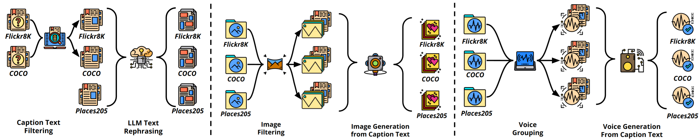
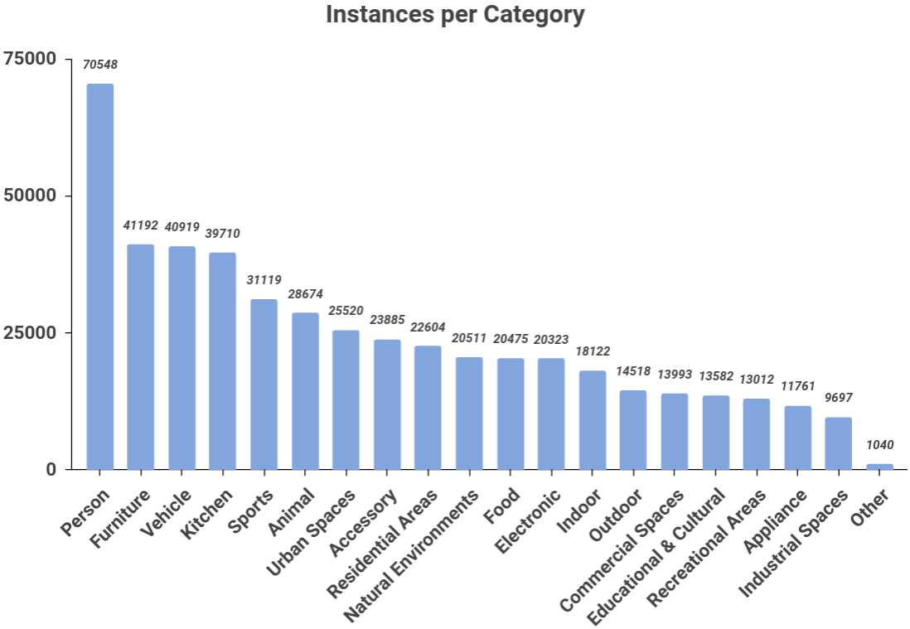

# RU-AI: Un gran conjunto de datos multimodal para la detección de contenido generado por máquinas

<!-- Hugging Face Dataset Badge -->
[](https://huggingface.co/datasets/zzha6204/RU-AI-noise) [](https://zenodo.org/records/11406538) [](https://arxiv.org/abs/2406.04906) [](https://creativecommons.org/licenses/by/4.0/)


# 📰 Noticias
**[¡Buenas noticias!] 🎉🎉🎉 Nuestro artículo ha sido aceptado en la Track de Recursos de WWW'25**

Este es el repositorio oficial del artículo: [RU-AI: Un gran conjunto de datos multimodal para la detección de contenido generado por máquinas](https://arxiv.org/abs/2406.04906)

# Introducción
El conjunto de datos está disponible públicamente en Zenodo y HuggingFace: 
```url
https://zenodo.org/records/11406538
```
```url
https://huggingface.co/datasets/zzha6204/RU-AI-origin
```

El conjunto de datos con aumento de ruido está disponible públicamente en HuggingFace: 
```url
https://huggingface.co/datasets/zzha6204/RU-AI-noise
```



## Comparación de conjuntos de datos
| **Conjunto de datos**      | **Modalidad**        | **Contenido**     | **Real/Humano**| **Contenido Generado por Máquina**| **Tarea**                           |
|----------------------------|----------------------|-------------------|---------------|-----------------------------------|-------------------------------------|
| M4                         | Texto                | General           | 10,019,311    | 122,481                           | Detección de Texto IA Multilingüe   |
| DeepfakeTextDetect         | Texto                | General           | 447,674       | 447,674                           | Detección Generalizada de Texto IA  |
| ArguGPT                    | Texto                | Ensayo            | 4,115         | 4,038                             | Detección de Texto IA para Aprendices de Idiomas |
| HC3                        | Texto                | Preguntas y Respuestas | 80,805     | 44,425                            | Detección de Respuestas IA          |
| CNNSpot                    | Imagen               | General           | 362,000       | 362,000                           | Detección de Imágenes IA            |
| DE-FAKE                    | Imagen               | General           | 20,000        | 191,946                           | Detección de Imágenes IA            |
| GenImage                   | Imagen               | General           | 1,331,167     | 1,350,000                         | Detección de Imágenes IA            |
| WaveFake                   | Voz                  | General           | 13,600        | 104,885                           | Detección de Voz Falsa              |
| Sprocket-VC                | Voz                  | General           | 3,132         | 3,456                             | Detección de Voz Falsa              |
| FakeAVCeleb                | Video-Voz            | Rostro            | 500           | 19,500                            | Detección de DeepFake               |
| ForgeryNet                 | Video-Imagen         | Rostro            | 1,438,201     | 1,457,861                         | Detección de DeepFake               |
| DFDC                       | Video-Imagen-Voz     | Rostro            | 23,654        | 104,500                           | Detección de DeepFake               |
| DGM4                       | Texto-Imagen         | General           | 77,426        | 152,574                           | Detección de Manipulación de Medios |
| **Nuestro**                | **Texto-Imagen-Voz**   | **General**           | **245,895**       | **1,229,475**                       | **Detección de Texto, Imagen y Voz IA**   |


## Requisitos

El conjunto de datos requiere al menos 500 GB de espacio en disco para descargarse completamente. 

La inferencia del modelo requiere una GPU NVIDIA con al menos 16 GB de vRAM para ejecutarse. Recomendamos contar con una **NVIDIA RTX 3090 de 24 GB o superior** para ejecutar este proyecto.

Recomendamos encarecidamente instalar este paquete dentro de un **entorno virtual** como **[conda](https://conda.io/projects/conda/en/latest/user-guide/install/index.html)** o **[venv](https://docs.python.org/3/library/venv.html)**.

Requisitos del entorno:
- Python >= 3.8
- Pytorch >= 1.13.1
- Versión de CUDA >= 11.6

Clona el proyecto:
```bash
git clone https://github.com/ZhihaoZhang97/RU-AI.git
```
Crea el entorno virtual con conda y Python 3.8:
```bash
conda create -n ruai python=3.8
```
Activa el entorno:
```bash
conda activate ruai
```
Cambia al directorio del proyecto:
```bash
cd RU-AI
```
Instala las dependencias:
```bash
pip3 install -r requirements.txt
```

## Ejemplo de datos
Proporcionamos un tutorial rápido sobre cómo descargar e inspeccionar el conjunto de datos en el notebook ```data-example.ipynb```. 

También puedes ejecutar directamente el siguiente código para descargar datos de ejemplo obtenidos de Flickr8k:
```bash
python ./download_flickr.py
```
También puedes descargar todos los datos ejecutando el siguiente código.

Ten en cuenta que el conjunto de datos completo **supera los 157 GB** en formato comprimido y podría ocupar **hasta 500 GB** después de descomprimirse. 

La descarga tardará un tiempo; la velocidad real depende de tu conexión a internet.
```bash
python ./download_all.py
```

También puedes ir a ```./data``` para verificar los datos manualmente después de la descarga.

A continuación se muestra el árbol de directorios después de descargar todos los datos:

```
├── audio
│   ├── coco
│   │   ├── efficientspeech
│   │   ├── real
│   │   ├── styletts2
│   │   ├── vits
│   │   ├── xtts2
│   │   └── yourtts
│   ├── flickr8k
│   │   ├── efficientspeech
│   │   ├── real
│   │   ├── styletts2
│   │   ├── vits
│   │   ├── xtts2
│   │   └── yourtts
│   └── place
│       ├── efficientspeech
│       ├── real
│       ├── styletts2
│       ├── vits
│       ├── xtts2
│       └── yourtts
├── image
│   ├── coco
│   │   ├── real
│   │   ├── stable-diffusion-images-absolutereality-remove-black
│   │   ├── stable-diffusion-images-epicrealism-remove-black
│   │   ├── stable-diffusion-images-v1-5
│   │   ├── stable-diffusion-images-v6-0-remove-black
│   │   └── stable-diffusion-images-xl-v3-0-remove-black
│   ├── flickr8k
│   │   ├── real
│   │   ├── stable-diffusion-images-absolutereality
│   │   ├── stable-diffusion-images-epicrealism
│   │   ├── stable-diffusion-images-v1-5
│   │   ├── stable-diffusion-images-v6-0
│   │   └── stable-diffusion-images-xl-v3-0
│   └── place
│       ├── real
│       ├── stable-diffusion-images-absolutereality-remove-black
│       ├── stable-diffusion-images-epicrealism-remove-black
│       ├── stable-diffusion-images-v1-5
│       ├── stable-diffusion-images-v6-0-remove-black
│       └── stable-diffusion-images-xl-v3-0-remove-black
└── text
    ├── coco
    ├── flickr8k
    └── place
```

## Categorías de objetos



## Inferencia del modelo

Antes de la inferencia del modelo, reemplaza `image_data_paths`, `audio_data_paths` y `text_data` en los archivos `infer_imagebind_model.py` y `infer_languagebind_model.py` con los datos reales/rutas de datos

Modelo basado en ImageBind
```bash
python infer_imagebind_model.py
```

Modelo basado en LanguageBind
```bash
python infer_languagebind_model.py
```

## Referencias
Agradecemos a la comunidad de código abierto por los conjuntos de datos y los modelos. 

[Microsoft COCO: Common Objects in Context](https://arxiv.org/abs/1405.0312)

[Framing Image Description as a Ranking Task: Data, Models and Evaluation Metrics ](https://www.jair.org/index.php/jair/article/view/10833)

[Learning Deep Features for Scene Recognition using Places Database](https://papers.nips.cc/paper_files/paper/2014/hash/3fe94a002317b5f9259f82690aeea4cd-Abstract.html)

[Text-Free Image-to-Speech Synthesis Using Learned Segmental Units](https://arxiv.org/abs/2012.15454)

[Unsupervised Learning of Spoken Language with Visual Context](https://papers.nips.cc/paper_files/paper/2016/hash/82b8a3434904411a9fdc43ca87cee70c-Abstract.html)

[Learning Word-Like Units from Joint Audio-Visual Analysis](https://aclanthology.org/P17-1047/)

[LanguageBind: Extending Video-Language Pretraining to N-modality by Language-based Semantic Alignment](https://arxiv.org/abs/2310.01852)

[ImageBind: One Embedding Space To Bind Them All](https://openaccess.thecvf.com/content/CVPR2023/papers/Girdhar_ImageBind_One_Embedding_Space_To_Bind_Them_All_CVPR_2023_paper.pdf)

## Cita
Si consideras útil nuestro conjunto de datos o nuestra investigación, por favor cita:
```text
@misc{huang2024ruai,
      title={RU-AI: A Large Multimodal Dataset for Machine Generated Content Detection}, 
      author={Liting Huang and Zhihao Zhang and Yiran Zhang and Xiyue Zhou and Shoujin Wang},
      year={2024},
      eprint={2406.04906},
      archivePrefix={arXiv},
      primaryClass={cs.CV}
}
```
